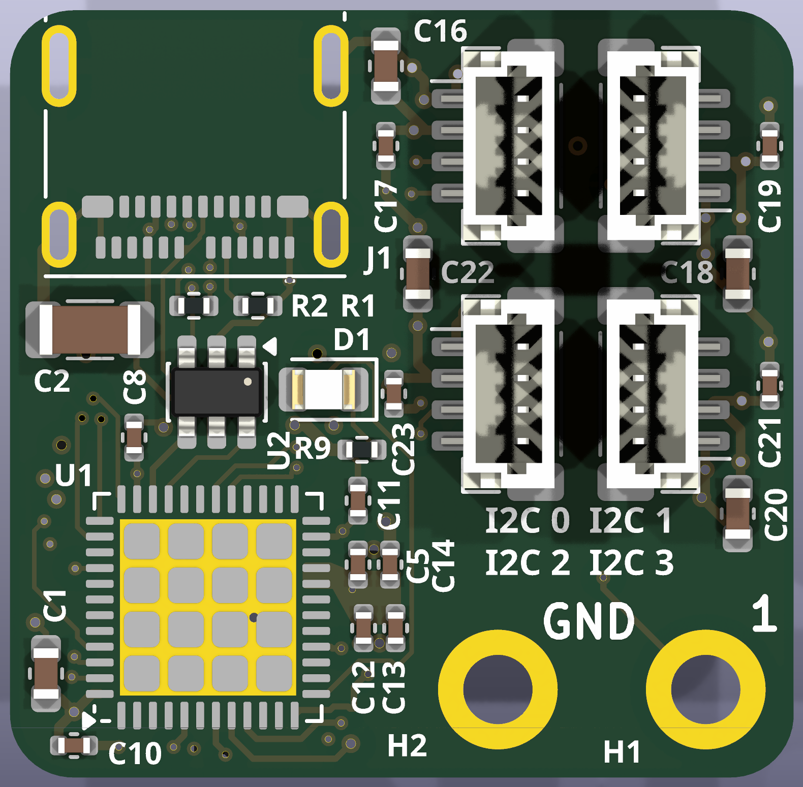
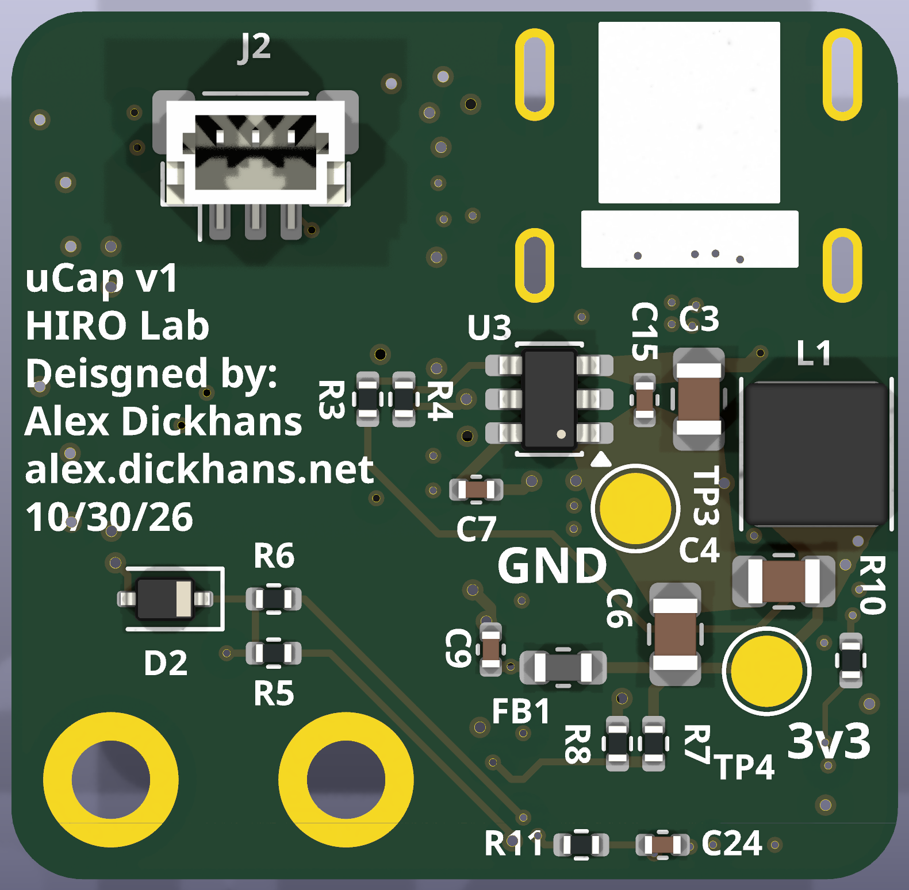
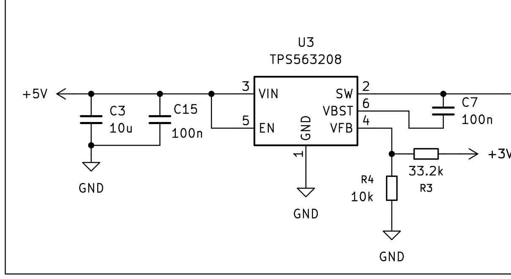
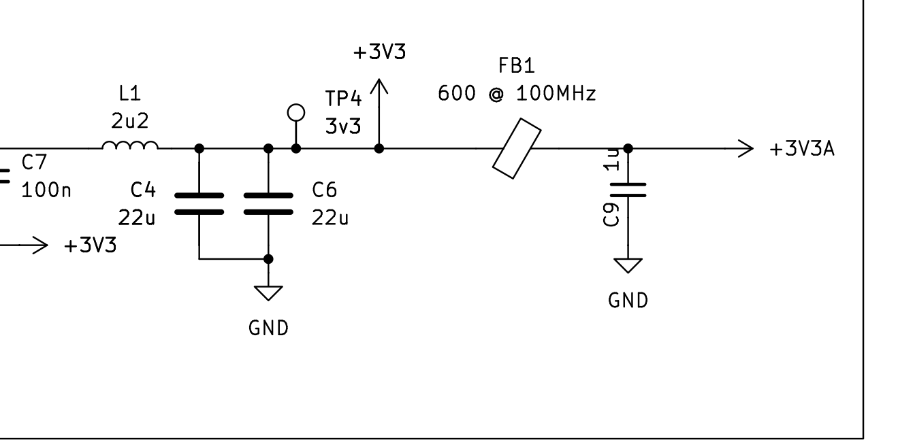
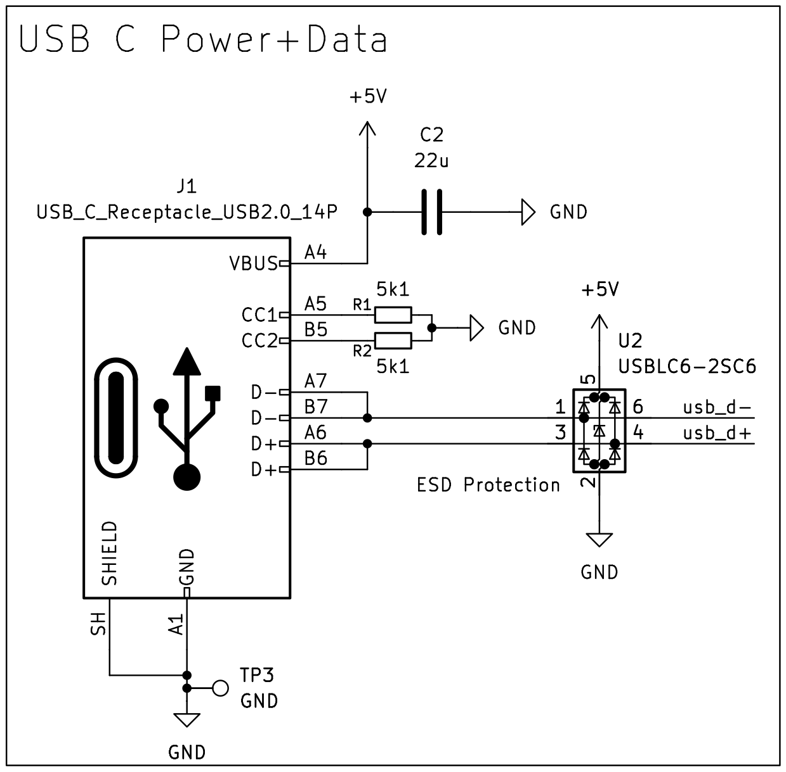
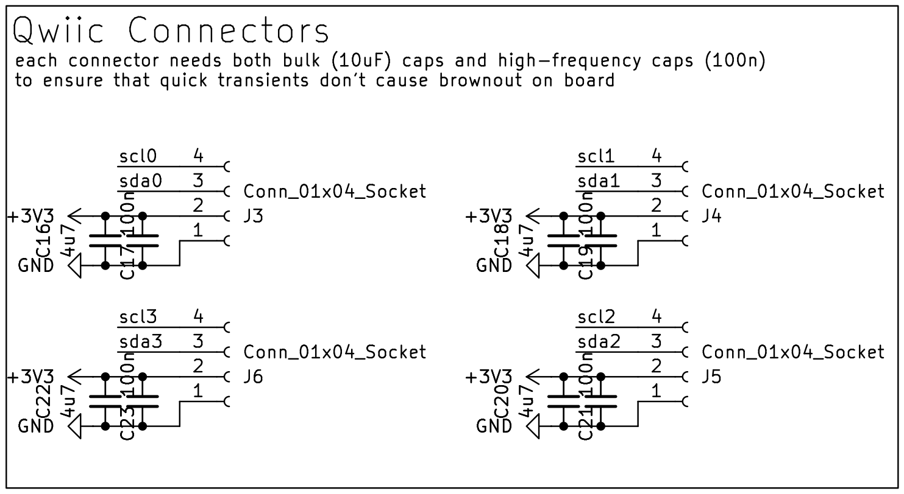
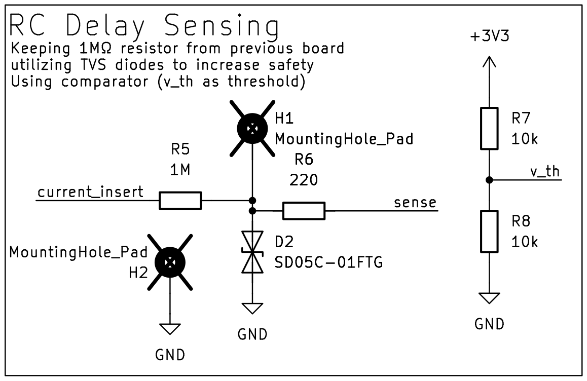
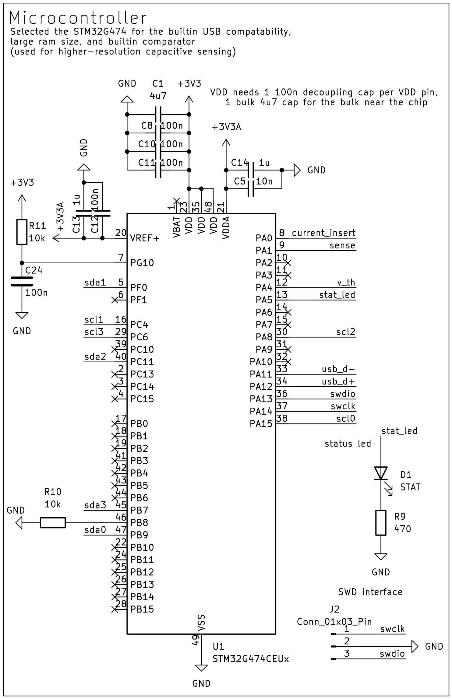

# uCap v1

uCap v1 is a USB-powered board for capacitive sensing. An STM32G474 reads a sense pad on one mounting hole, and four JST SH sockets carry I2C. The name is the one printed on the back of the board. Open the project in KiCad 10 (`ucap/ucap.kicad_pro`).

The board is 24.9 mm by 24.4 mm.

## Pictures

Top of the board, USB edge up. The four white housings are the JST SH sockets. J1, along the top edge, is the USB-C footprint: the yellow slots are its plated shell holes, and the connector body is not drawn. U1 is the QFN footprint: the yellow grid is the exposed pad, and the chip body is not drawn. The silk dot at the lower-left corner of that land is pin 1.

Bottom of the board, USB edge still up. J2 is the SWD socket. U3 is the regulator and L1 is the inductor. TP3 and TP4 are the round pads marked GND and 3v3. The white block and the yellow slots along the top of this view are the underside of the connectors on the top.

The buck, from the 5 V input through U3. EN is tied to VIN. The wire leaving to the right is the switch node and continues in the next figure.

The rest of the 3.3 V rail. L1 is 2.2 µH. C9, 1 µF, sits on +3V3A after the ferrite.

USB-C power and data. Both CC pins have 5.1 kΩ to ground. U2 is the USBLC6-2SC6 on D+ and D−.

The four I2C sockets on the schematic. J3 is I2C 0 and J4 is I2C 1. This sheet draws J6 at the lower left and J5 at the lower right. On the board, I2C 2 (J5) is the lower left socket and I2C 3 (J6) is the lower right. The capacitors drawn here are 4.7 µF and 100 nF.

The sense circuit. H1 is the sense node. H2 is ground. D2 is the bidirectional TVS, SD05C-01FTG.

The microcontroller, the status LED, and the SWD socket. PG10 is reset. PB8 is BOOT0.

## Connectors, holes, and test points

Silkscreen reference designators match the table. Pin 1 of the JST sockets is not numbered on the silk. The ends below were taken from the pad coordinates on this board.

Looking at the top, with the USB edge up:

| Silk | Side | What you see | Pins |
| --- | --- | --- | --- |
| J1 | top | USB-C footprint at the top edge. The plug enters from that edge. | VBUS (A4, A9, B4, B9) is +5 V. CC1 and CC2 each have 5.1 kΩ to ground. D+ is tied between A6 and B6, and D− between A7 and B7, so either plug orientation works. Shield is ground. SuperSpeed and SBU pins are open. |
| J3, under “I2C 0” | top | Upper-left JST SH, 4 pin. Contacts are on the left side of the housing. | From the USB edge: 1 ground, 2 +3.3 V, 3 SDA (PB9), 4 SCL (PA15). Pin 1 is the contact nearest the USB edge. |
| J4, under “I2C 1” | top | Upper-right JST SH, 4 pin. Contacts are on the right side of the housing. | From the USB edge: 4 SCL (PC4), 3 SDA (PF0), 2 +3.3 V, 1 ground. Pin 1 is the contact away from the USB edge. |
| J5, under “I2C 2” | top | Lower-left JST SH, 4 pin. Same orientation as J3. | From the top of that socket: 1 ground, 2 +3.3 V, 3 SDA (PC11), 4 SCL (PA8). |
| J6, under “I2C 3” | top | Lower-right JST SH, 4 pin. Same orientation as J4. | From the top of that socket: 4 SCL (PC6), 3 SDA (PB7), 2 +3.3 V, 1 ground. Pin 1 is the lower contact. |
| 1 | top | The right-hand 2.2 mm hole, H1. | The sense node, the same net as D2 and R5. |
| GND | top | The left-hand 2.2 mm hole, H2. The GND silk sits between the holes. | Ground. |
| J2 | bottom | 3-pin JST SH. In the bottom picture, its contacts point away from the USB edge. | Left contact is pin 1, SWCLK (PA14). Middle is ground. Right contact is pin 3, SWDIO (PA13). No 3.3 V and no reset on this socket. |
| GND by TP3 | bottom | Round pad | Ground. |
| 3v3 by TP4 | bottom | Round pad | +3.3 V, the regulator output. |

Each I2C socket has a 4.7 µF capacitor and a 100 nF capacitor from its 3.3 V pin to ground.

## Power

Plug in USB. That is the only power input. VBUS is +5 V, and either orientation of the plug works. The 5.1 kΩ resistors on CC1 and CC2 make this a USB device. The host has to supply 5 V.

There is no battery connector, no charger, and no diode between VBUS and the regulator. U3, a TPS563208, runs whenever VBUS is present because its enable pin is tied to its input. L1 is 2.2 µH. R3, 33.2 kΩ, and R4, 10 kΩ, set the feedback. The TPS563208 reference is 0.768 V, so the output is about 3.32 V. FB1, 600 Ω at 100 MHz, feeds +3V3A, which is VDDA and VREF+.

Pin 2 of J3, J4, J5, and J6 is that 3.3 V output. Do not power the board from those pins.

U1 pin 1, VBAT, is not connected. PG10 (pin 7) is reset: R11, 10 kΩ, pulls it up to 3.3 V, and C24, 100 nF, goes to ground. There is no reset button, and J2 does not carry reset, so a debugger on J2 cannot reset the chip. PB8 (pin 46) is BOOT0. R10, 10 kΩ, holds it at ground. If that pin is high at reset, the chip can boot the system loader instead of flash.

D1 is the status LED. Its comment in the BOM is STAT. The part is a green 0805 LED. The cathode, pad 1, is the end toward the I2C sockets. The anode goes to PA5. A high on PA5 lights it. R9, 470 Ω, is between the cathode and ground.

The two holes are part of the circuit. H1, the hole by the silk “1”, is the sense electrode. PA0 drives it through R5, 1 MΩ. PA1 reads it through R6, 220 Ω. D2 clamps that node to ground. H2 is ground. R7 and R8, both 10 kΩ, divide 3.3 V in half for the comparator threshold on PA4.

## Manufacture

Order a 6-layer board, 1.6 mm thick, 1 oz (35 µm) copper on all six layers. The stackup in the board file is FR4 with 0.1 mm prepreg, 0.535 mm core, 0.1 mm prepreg, 0.535 mm core, and 0.1 mm prepreg. A prototype shop can use its standard 6-layer 1.6 mm stack. Impedance control is not required. The board file leaves the surface finish unset, so a normal prototype finish is fine.

The smallest trace is 0.15 mm. The smallest space is 0.127 mm. The smallest via is a 0.45 mm pad with a 0.20 mm drill. There are also 0.6 mm vias with a 0.30 mm drill. Every hole is plated, including the four USB shell slots and the two 2.2 mm holes. There is no unplated drill file.

The inner ground fills and the inner 3.3 V fill come to 0.30 mm of the outline. A shop whose copper-to-edge limit is 0.2 mm will pass. A shop whose limit is 0.3 mm may flag those fills. Leave the connector where it is. Accept that warning when the USB pads and the holes are still intact in the preview. The USB silkscreen also runs into the outline. That is expected.

Gerbers, the drill, the BOM, and the placement file were exported from this revision.

`ucap/production/ucap.zip` contains the six copper layers, both solder masks, both silkscreens, both pastes, the board outline, and one Excellon drill. Extensions are Protel. Coordinates are millimeters, absolute origin, and the same origin as the placement file, including the negative Y. Soldermask is subtracted from the silkscreen. The zip has no drill map, no job file, and no empty unplated-hole file.

`ucap/production/ucap-bom.csv` columns are Designator, Comment, Footprint, Qty, and LCSC Part #. Comment is the value on the symbol. H1 and H2 are left off on purpose: they are marked do-not-populate and excluded from the BOM. The holes are still drilled.

A few comments do not say what the assembler expects:

- D1’s comment is STAT. Order the green 0805 LED, Hubei KENTO KT-0805G, LCSC C2297.
- J1’s comment is USB_C_Receptacle_USB2.0_14P. The footprint and LCSC C134092 are the Molex 105450-0101, a 24-position Type-C receptacle. Only USB 2.0 is wired.
- FB1 is a ferrite bead, Sunlord GZ1608D601TF, 600 Ω at 100 MHz, on an 0603 inductor land. It is not a wound inductor.
- L1’s footprint is named L_APV_ANR4020. The part is a 4×4 mm 2.2 µH inductor, Sunlord WPN4020H2R2MT, LCSC C98361.
- U3’s footprint is named SOT-23-6. The part is the TPS563208DDCR in TSOT-23-6, which uses that land.
- TP3 and TP4 are copper pads. The LCSC cell is blank because there is nothing to buy. U1 is the STM32G474CEU6, LCSC C1235412. D2 is the Littelfuse SD05C-01FTG, LCSC C118264.

`ucap/production/ucap-pos.csv` is one KiCad placement file for both sides, in millimeters. DNP parts are excluded, so H1 and H2 are not in it. The header is Designator, Val, Package, Mid X, Mid Y, Rotation, Layer. Y is negative, matching the gerbers. Bottom X is not negated. Bottom rotations are KiCad’s. Many assemblers mirror the bottom. Check the placement preview before paying.

Parts that are easy to rotate wrong: U1, U2, U3, D1, J1, J2, and every part on the bottom. Those bottom parts are C3, C4, C6, C7, C9, C15, C24, D2, FB1, J2, L1, R3, R4, R5, R6, R7, R8, R10, R11, TP3, TP4, and U3. On the top, U1 pin 1 is the lower-left corner of the land. D1’s cathode is the end toward the I2C sockets. J1’s opening faces the top edge. On the bottom picture, U3 pin 1 (ground) is the lower pin on the right side of the package, and J2 pin 1 is the left contact. D2 is bidirectional, so turning it around does not swap the circuit.

## Firmware

PlatformIO firmware for the STM32G474 lives in [`firmware/`](firmware/README.md). It drives the COMP1+TIM2 capacitance path, the four Qwiic I2C buses, an LIS3MDL magnetometer, and up to three SparkFun VL53L5CX ToF imagers.

## ROS 2

[`ros2/ucap_sensor/`](ros2/ucap_sensor/README.md) is an `ament_python` node that reads the board’s USB CDC telemetry (115200) and publishes capacitance, ADC, magnetometer, and ToF topics.

## Design files

- `ucap/ucap.kicad_pro`, `ucap/ucap.kicad_sch`, `ucap/ucap.kicad_pcb` — KiCad 10 project
- `ucap/production/ucap.zip` — gerbers and drill
- `ucap/production/ucap-bom.csv` — bill of materials
- `ucap/production/ucap-pos.csv` — placement, both sides
- `firmware/` — board bring-up and sensor firmware
- `ros2/ucap_sensor/` — ROS 2 USB CDC host node
